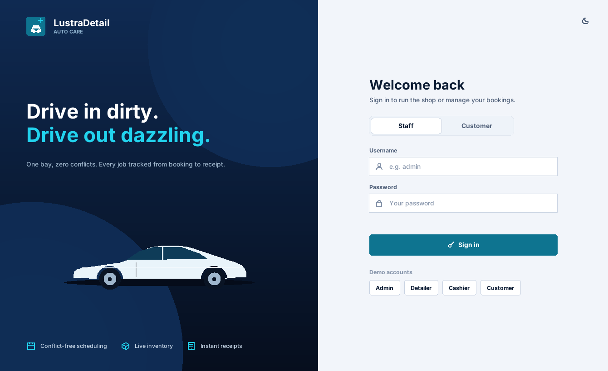
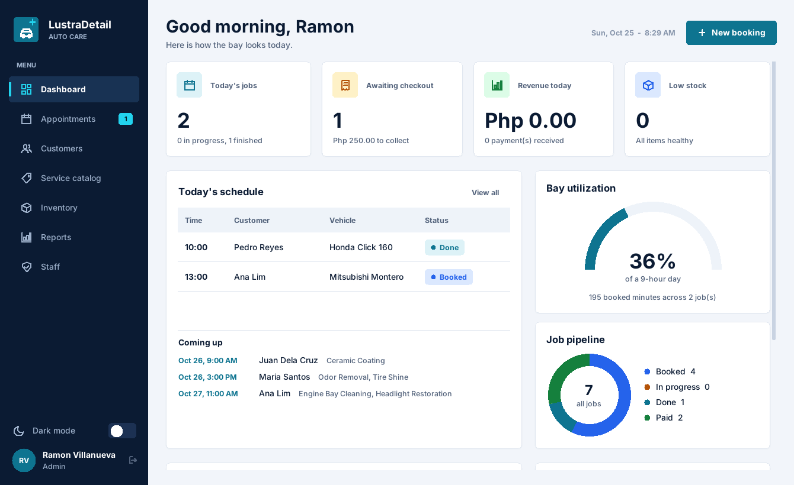
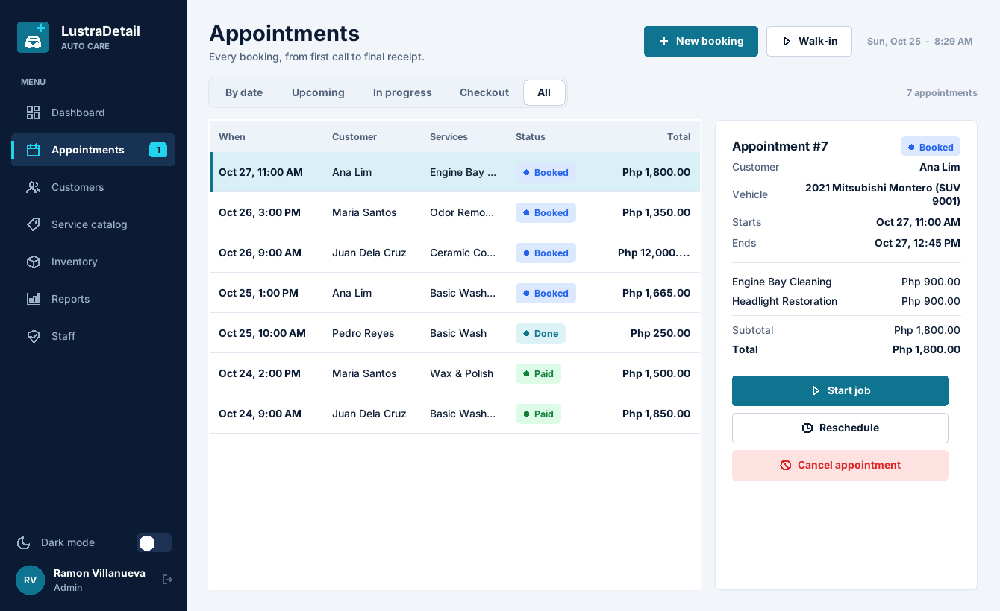
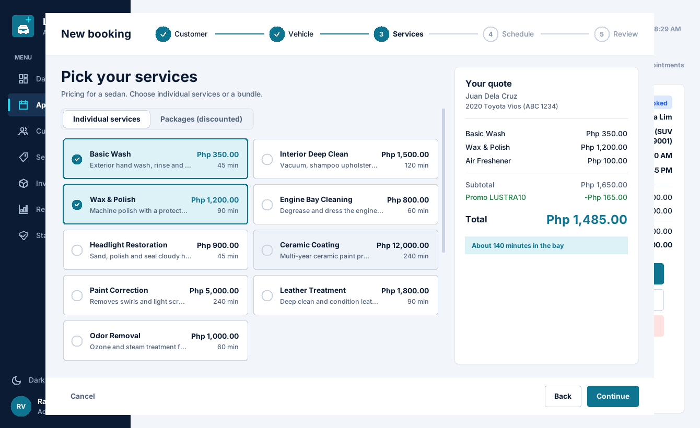
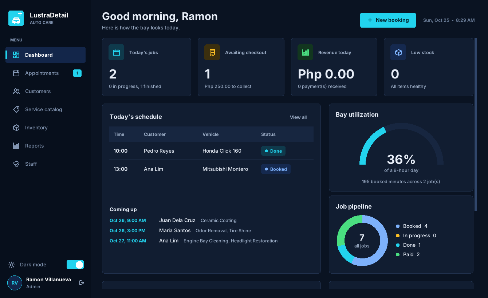
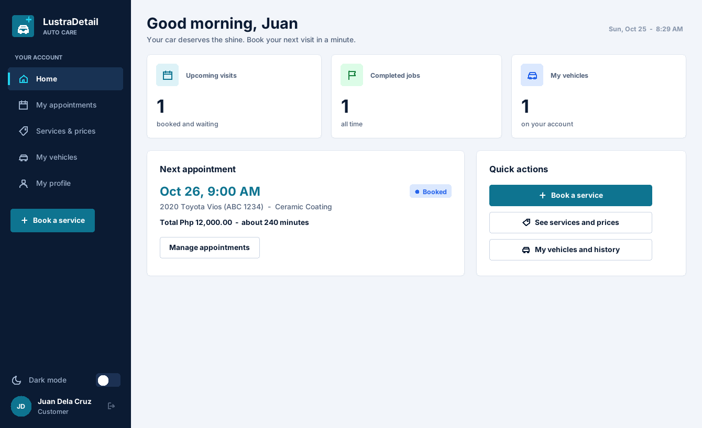

<div align="center">



# LustraDetail Auto Care

**A desktop management system for a one-bay auto detailing shop**

Python 3.10+ | Standard library only | Tkinter | pytest

</div>

---

## Table of Contents

1. [Overview](#overview)
2. [Academic Context](#academic-context)
3. [Features](#features)
4. [Getting Started](#getting-started)
5. [Demo Accounts](#demo-accounts)
6. [Screenshots](#screenshots)
7. [Architecture](#architecture)
8. [Project Structure](#project-structure)
9. [Scheduling Rules](#scheduling-rules)
10. [Data Files](#data-files)
11. [Testing](#testing)
12. [User Interface](#user-interface)
13. [Contributing](#contributing)
14. [Authors](#authors)

---

## Overview

LustraDetail Auto Care is a fictional one-bay detailing shop located in Quezon City. This project implements the shop's entire back office as a desktop application written in pure Python and Tkinter, with no third-party dependencies.

Staff members sign in to run daily operations. Customers sign in with only their phone number to book and manage their own appointments. Every business rule, including pricing, scheduling conflicts, stock levels and payments, is enforced by validated service-layer logic. Each completed job produces an official receipt that is saved to disk.

---

## Academic Context

This system was developed by third year Bachelor of Science in Information Technology (BSIT) students of the Technological University of the Philippines (TUP), Taguig Campus. It is submitted as the final project for the course **IT Professional Elective 1**.

---

## Features

| Area | Description |
|---|---|
| Service catalog | 9 detailing services with a price and duration matrix across 5 vehicle types, 5 add-ons, 3 discounted packages and promo codes |
| Scheduling | Booking by date and time, automatic job duration, overlap detection with a 15-minute bay buffer, next free slot suggestions, walk-ins, rescheduling, cancellations and no-show tracking |
| Job pipeline | `BOOKED`, `IN PROGRESS`, `DONE` and `PAID` states with guarded transitions, each step validated |
| Customers and vehicles | Registry with contact details, plate, make, model, year, color and notes. Duplicate phone and plate protection. Per-vehicle service history |
| Inventory | Chemicals, towels, coatings and film. Stock is deducted automatically when a job starts, bookings are blocked when stock is insufficient, and low-stock alerts support restocking |
| Payments | Deposits at booking, balance checkout, cash change computation, GCash, bank and card support, and an itemized receipt per order |
| Reports | Daily sales, top services, bay utilization and shop summary, with live charts on the dashboard |
| Staff | Three roles (admin, detailer, cashier) with role-based sidebar menus and staff management (add, activate, deactivate) |
| Customer portal | Self-service price browsing, booking, rescheduling, cancellation and vehicle history |
| Interface | Animated splash screen, sidebar navigation, light and dark themes remembered between runs, step-by-step booking wizard, toast notifications and HiDPI-aware sizing |
| Storage | JSON files with atomic writes and automatic `.bak` corruption recovery |

---

## Getting Started

### Requirements

- Python 3.10 or newer (3.12 recommended) with Tkinter. Tkinter ships with the python.org installers for Windows and macOS. On Linux, install it with `sudo apt install python3-tk` (Debian and Ubuntu) or `sudo dnf install python3-tkinter` (Fedora).
- No `pip install` is required. The application uses only the standard library.
- A display of at least 1180 x 720. The window scales to fit smaller screens.

### Installation

```bash
# 1. Clone the repository
git clone https://github.com/ZEB3Z/lustradetail.git
cd lustradetail

# 2. (Optional, recommended) Create a virtual environment
python -m venv .venv
source .venv/bin/activate        # Windows: .venv\Scripts\activate

# 3. Run the application
python main.py
```

On first launch, the system seeds itself with a demo dataset containing customers, vehicles, staff, the service catalog and a week of sample bookings. Booking dates are relative to the current day, so the dashboard and reports always have data to display.

### Command-line Options

| Command | Description |
|---|---|
| `python main.py` | Opens the desktop application and seeds demo data on first run |
| `python main.py --reseed` | Wipes and rebuilds all data files, useful before a demonstration or defense |
| `python main.py --help` | Displays usage information |

---

## Demo Accounts

| Role | Credentials | Access |
|---|---|---|
| Admin | `admin` / `admin123` | Full access, including staff management |
| Detailer | `alwin` / `detail123` | Dashboard, start and complete jobs, catalog, inventory |
| Cashier | `cashier` / `cash123` | Bookings, checkout and receipts, customers, sales reports |
| Customer | Phone `09171234567` (Juan Dela Cruz) | Customer portal. A new account can also be registered from the portal |

> **Note:** Passwords are stored in plain text in `data/staff.json`. This is a deliberate and documented decision for this academic project. See `CONTRIBUTING.md` for details.

---

## Screenshots

| | |
|---|---|
|  |  |
| **Dashboard.** KPIs, today's schedule, bay utilization and job pipeline | **Appointments.** Filter, inspect and act on every booking |
|  |  |
| **Booking wizard.** Live quote while services are selected | **Dark mode.** Toggled from the sidebar |
|  | |
| **Customer portal.** Customers sign in with their phone number | |

### Sample Receipt

Each paid job generates an official receipt such as `receipts/receipt_0003.txt`:

```
======================================================
                 LustraDetail Auto Care
             "Drive in dirty. Drive out dazzling."
            123 Shine Avenue, Quezon City, Philippines
                  Tel: 0917 000 1234
======================================================
OFFICIAL RECEIPT                             No. 00003
--------------------------------------------------
Customer : Juan Dela Cruz
Phone    : 09171234567
Vehicle  : Toyota Vios 2019 (Silver) [ABC 1234]
Paid at  : 2025-06-05 16:02
Cashier  : Mara Santos
--------------------------------------------------
SERVICES
  Basic Wash ..................... Php 350.00
  Interior Detailing ............. Php 1,500.00
--------------------------------------------------
  Subtotal ....................... Php 1,850.00
  TOTAL .......................... Php 1,850.00
--------------------------------------------------
Payment method : gcash
--------------------------------------------------
          Thank you for trusting LustraDetail!
       This serves as your official receipt.
======================================================
```

---

## Architecture

LustraDetail follows a strict layered architecture. Each layer may communicate only with the layer directly below it. This separation allowed the interface to be rebuilt from a terminal application into a Tkinter GUI without modifying any business rule.

```
+-----------------------------------------------------+
|  UI LAYER (app/ui)                                  |
|  Tkinter windows, widgets and charts. The only      |
|  layer that draws on screen or reads input.         |
+------------------------+----------------------------+
                         v
+-----------------------------------------------------+
|  SERVICE LAYER (app/services)                       |
|  All business rules: quotes, conflicts, payments,   |
|  inventory and reports. Never prints. Raises typed  |
|  exceptions (AppError family) instead.              |
+------------------------+----------------------------+
                         v
+-----------------------------------------------------+
|  STORAGE LAYER (app/storage)                        |
|  Repositories and atomic JSON writes with .bak      |
|  corruption recovery.                               |
+------------------------+----------------------------+
                         v
+-----------------------------------------------------+
|  MODELS (app/models)          |  DATA (data/*.json) |
|  Plain dataclasses            |  receipts/*.txt     |
+-----------------------------------------------------+
```

### Job Pipeline

```
                 +--------+     +-------------+     +------+     +------+
  book job ----> | BOOKED | --> | IN PROGRESS | --> | DONE | --> | PAID |
                 +---+----+     +-------------+     +------+     +------+
                     |                (start deducts     (checkout writes
                     |                 inventory)        receipt + history)
                     +--> CANCELLED
                     +--> NO_SHOW   (only after the scheduled time passed)
```

Every transition is guarded. A job cannot be started twice, rescheduled once it is in the bay, paid before completion, or marked as a no-show before its scheduled time has passed.

---

## Project Structure

```
lustradetail/
├── main.py                  # Entry point
├── app/
│   ├── application.py       # Wires repositories and services into one stack
│   ├── config.py            # Branding, paths and business rules
│   ├── defaults.py          # Seed content for all data files
│   ├── exceptions.py        # AppError family
│   ├── models/              # Dataclasses: Customer, Vehicle, Appointment, ...
│   ├── storage/             # JSON store (atomic + .bak) and repositories
│   ├── services/            # Auth, catalog, customers, bookings, inventory,
│   │                        # payments, reports, staff, demo seeding
│   ├── ui/                  # Tkinter interface: theme, widgets, charts, splash,
│   │   │                    # shell (sidebar), login, booking wizard, dialogs
│   │   └── pages/           # Dashboard, appointments, customers, catalog,
│   │                        # inventory, reports, staff, customer portal
│   └── utils/               # Dates, validation, formatting
├── data/                    # JSON data store (7 files, auto-created)
├── receipts/                # Generated official receipts (.txt)
├── docs/screenshots/        # Images used in this README
├── tests/                   # pytest suite (business rules, storage, UI smoke test)
└── .github/                 # CI workflow and issue/PR templates
```

---

## Scheduling Rules

The shop operates a single detailing bay and accepts bookings around the clock, with no fixed operating hours. The following rules keep the bay schedule consistent:

1. Bookings cannot start in the past.
2. Two jobs cannot overlap.
3. Consecutive jobs require a buffer of at least 15 minutes for setup and cleanup. This value is set by `BOOKING_BUFFER_MINUTES` in `app/config.py`.
4. Only `BOOKED` and `IN PROGRESS` appointments block the bay. Cancelled and no-show slots are released immediately.
5. The system can suggest the next free slots for any job duration.

---

## Data Files

All data is stored in the `data/` directory as human-readable JSON.

| File | Contents |
|---|---|
| `customers.json` | Customer registry (id, name, phone, email, notes) |
| `vehicles.json` | Vehicles linked to customers (plate, make, model, year, color, type) |
| `appointments.json` | Bookings with full price breakdown, status, deposits and payments |
| `service_catalog.json` | Services (price and duration matrix), add-ons, packages and promos |
| `inventory.json` | Stock levels and reorder points for all materials |
| `staff.json` | Staff accounts and roles |
| `service_history.json` | Per-vehicle completed job history |

To adjust prices or add a service, edit `service_catalog.json` and restart the application. Existing bookings keep their originally quoted prices because a price snapshot is stored with each appointment.

---

## Testing

The repository includes a pytest suite covering quotes, scheduling conflicts, inventory safeguards, payments, storage recovery and reports.

```bash
python -m pip install -r requirements-dev.txt   # Installs pytest
python -m pytest                                # Runs the full suite
```

The suite runs automatically on every push through GitHub Actions (`.github/workflows/ci.yml`) on Python 3.10 and 3.12.

---

## User Interface

The front end lives in `app/ui/` and is built from Tkinter and ttk only. There is no dependency on Pillow or customtkinter. Rounded cards, vector icons, charts and animations are drawn directly on `Canvas`.

| File | Role |
|---|---|
| `theme.py` | Light and dark palettes, named fonts, DPI scaling and saved preference (`.lustra_ui.json`) |
| `widgets.py` | Buttons, cards, fields, tables, dialogs, toasts and date pickers |
| `charts.py` | Bar chart, donut, gauge and ranked bar list |
| `splash.py`, `brand.py` | Animated launch screen and the car illustration |
| `shell.py` | Sidebar navigation, page header and role-based menus |
| `login.py` | Staff and customer sign-in with lockout after 3 failed attempts |
| `wizard.py`, `dialogs.py` | Booking wizard and smaller modal forms |
| `pages/` | One module per screen |

The architectural rules remain intact. Every screen receives the same injected `stack` of services, services never draw or prompt (they raise typed exceptions), and `build_stack()` in `app/application.py` is unchanged. The JSON storage can later be replaced with SQLite behind the same repository interfaces without modifying the services or the UI.

Press **F11** to toggle fullscreen.

---

## Contributing

Pull requests are welcome. Please read [`CONTRIBUTING.md`](CONTRIBUTING.md) for the layer rules (the UI contains no business logic and services never touch the screen) and the testing requirements. For significant changes, please open an issue first to discuss the proposal.

---

## Authors

Third year BSIT students, Technological University of the Philippines, Taguig Campus.
Developed as the final project for IT Professional Elective 1.

- **Ericksson Brutas** ([GitHub](https://github.com/ZEB3Z))
- **Alwin Benitez** ([GitHub](https://github.com/alwincroissant))
